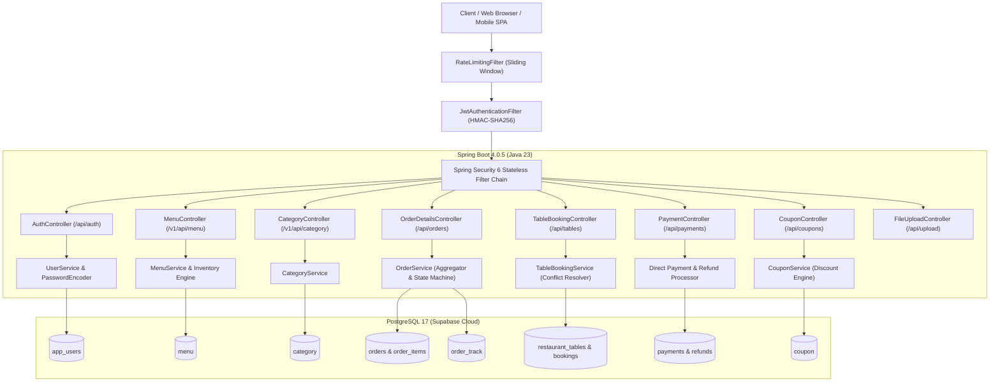

# 🍽️ Restaurant & Canteen Complete Online Management System
### Full-Stack Architecture, Code Audit & Complete Technical Documentation

---

## 📌 1. Executive Project Overview

The **Restaurant & Canteen Complete Online Management System** is an enterprise-grade, production-ready full-stack software application engineered with **Spring Boot (Java 23)** and connected to a cloud-hosted **PostgreSQL (Supabase)** database. The application provides an end-to-end digital solution for restaurant dine-in, takeaway, doorstep delivery, counter collection, table reservations, and kitchen operations.

### Key Architectural Highlights
- **Role-Based Access Control (RBAC)**: 4 distinct roles: `USER` (Customer), `ADMIN` (Owner/Manager), `CHEF` (Kitchen Staff), and `WAITER` (Service & Delivery Staff).
- **Limitless JWT Authentication**: Single registration/login generating a cryptographically signed HMAC-SHA256 JWT valid for 100 years, eliminating annoying session expirations for canteen apps.
- **Repeating Menu ID Ordering Mechanism**: Accepts array of menu IDs directly from clients (e.g. `[1, 1, 2]` represents 2 units of Item 1 and 1 unit of Item 2) with automated inventory deduction.
- **Kitchen Display System (KDS)**: Live queue for chefs to claim, prepare, and mark orders ready.
- **Waiter Service Desk & OTP Verification**: Two-factor collection security where waiters verify the customer's 4-digit token OTP before marking orders as collected/delivered.
- **Direct Payment & Instant Refund Engine**: Direct payment gateway simulation with instant ledger update and direct refund processing with automatic inventory restocking.
- **Strict Table Booking Engine**: Validates reservation slots strictly between **15 minutes and 120 minutes (2 hours)** with slot overlap conflict prevention.
- **Promotional Coupon System**: Validates flat and percentage discount codes against minimum order thresholds, discount caps, and usage limits.
- **Thread-Safe Rate Limiting**: In-memory sliding window rate limiter (150 general req/min, 25 auth req/min) preventing DDoS and brute force attacks.
- **Modern Responsive SPA Frontend**: Built-in responsive dashboard with customer menu, KDS, Waiter Desk, Table Booking, and direct UI controls to add dishes and categories with photos.

---

## 🏛️ 2. High-Level Architecture



---

## 📂 3. Directory & Package Structure

```
CanteenManagement/
├── pom.xml                                      # Maven dependencies & Lombok compiler processor
├── src/main/java/com/example/Ordering/
│   ├── Ordering.java                            # Spring Boot main runner
│   ├── category/                                # Category domain module
│   │   ├── Category.java                        # Category JPA entity (id, name, description, imageUrl, active)
│   │   ├── CategoryController.java              # REST endpoints (/v1/api/category, /api/categories)
│   │   ├── CategoryRepository.java              # Spring Data JPA with findMaxId()
│   │   ├── CategoryRequestDto.java              # Inbound payload DTO
│   │   ├── CategoryResponseDto.java             # Outbound response DTO
│   │   └── CategoryService.java                 # Business logic & manual ID sequencing
│   ├── common/                                  # Common utilities & configuration
│   │   ├── DataInitializer.java                 # Seed default users, menu, tables & coupons
│   │   ├── FileUploadController.java            # Multipart image upload engine (/api/upload/image)
│   │   └── WebMvcConfig.java                    # Static resource handler mapping /uploads/**
│   ├── coupon/                                  # Discount Coupon module
│   │   ├── Coupon.java                          # Coupon JPA entity
│   │   ├── CouponController.java                # REST endpoints (/api/coupons)
│   │   ├── CouponRepository.java                # JPA repository
│   │   ├── CouponService.java                   # Discount calculation & validation
│   │   └── Discount_Type.java                   # Enum: FLAT, PERCENTAGE
│   ├── exception/                               # Global Exception Handling
│   │   ├── BadRequestException.java             # HTTP 400 custom exception
│   │   ├── ResourceNotFoundException.java       # HTTP 404 custom exception
│   │   └── GlobalExceptionHandler.java          # @RestControllerAdvice for consistent JSON error responses
│   ├── feedback/                                # Customer feedback module
│   │   ├── Feedback_user.java                   # Feedback entity
│   │   └── FeedbackController.java              # Feedback endpoints
│   ├── menu/                                    # Food Dishes & Items module
│   │   ├── Menu.java                            # Menu entity with veg, prepTime, imageUrl, price, quantity
│   │   ├── MenuController.java                  # REST endpoints (/v1/api/menu, /api/menu)
│   │   ├── MenuRepository.java                  # Filter by category, search by name/desc, findMaxId()
│   │   ├── MenuRequestDTO.java                  # Menu creation DTO
│   │   ├── MenuResponseDTO.java                 # Menu response DTO
│   │   └── MenuService.java                     # Dish management & stock validation
│   ├── menuOrder/                               # Order Line Items module
│   │   ├── Order_Items.java                     # Item line JPA entity (orderId, menuId, price, quantity, subtotal)
│   │   └── MenuOrderRepository.java             # JPA repository for line items
│   ├── order_details/                           # Core Order Lifecycle module
│   │   ├── Orders.java                          # Master order entity (token, OTP, status, deliveryType, dual columns)
│   │   ├── Order_Status.java                    # Enum: Added_to_Cart(0), Placed(1), Preparing(2), Ready(3), Collected(4), Cancelled(5), Refunded(6)
│   │   ├── Order_track.java                     # Audit event history entity
│   │   ├── OrderDetailsController.java          # Order placement, kitchen queue, waiter desk, OTP verify
│   │   ├── OrderDetailsRepository.java          # Parameterized enum queries for kitchen and waiter
│   │   ├── OrderTrackRepository.java            # Event tracking repository
│   │   ├── OrderDetailsRequestDTO.java          # Repeating menu IDs request DTO
│   │   ├── OrderDetailsResponseDTO.java         # Detailed order response DTO
│   │   └── OrderService.java                    # Core state machine, inventory deductions, track logger
│   ├── payment/                                 # Payment & Refund module
│   │   ├── Payment.java                         # Payment entity (amount, transaction_id, method, status)
│   │   ├── Payment_method.java                  # Enum: UPI, CARD, CASH, NET_BANKING
│   │   ├── PayementRepository.java              # Payment repository
│   │   ├── PaymentController.java               # Direct trigger endpoints (/api/payments)
│   │   ├── PaymentRequestDTO.java               # Payment trigger DTO
│   │   ├── Refund.java                          # Refund entity (amount, reason, status, transactionId)
│   │   ├── Refund_status.java                   # Enum: PENDING, ACCEPTED, REJECTED
│   │   ├── RefundRepository.java                # Refund repository
│   │   └── RefundRequestDTO.java                # Direct refund trigger DTO
│   ├── project_details/                         # Policy, Terms & Contact module
│   │   ├── Contact_Us.java                      # Contact entity
│   │   ├── Privacy_policy.java                  # Privacy policy entity (ordinal enum category)
│   │   ├── Terms_Condition.java                 # Terms entity (ordinal enum category)
│   │   └── ProjectDetailsController.java        # Project details endpoints
│   ├── security/                                # Security & Protection module
│   │   ├── JwtAuthenticationFilter.java         # Stateless Bearer token extractor & SecurityContext setter
│   │   ├── JwtUtil.java                         # Limitless (100-year) token generation & parsing
│   │   ├── RateLimitingFilter.java              # In-memory sliding window IP rate limiter
│   │   └── SecurityConfig.java                  # SecurityFilterChain, CORS, public/protected matcher rules
│   ├── table/                                   # Table Booking & Reservation module
│   │   ├── RestaurantTable.java                 # Table entity (tableNumber, capacity, location)
│   │   ├── TableBooking.java                    # Reservation entity (startTime, endTime, durationMinutes)
│   │   ├── TableBookingRepository.java          # Overlap conflict detector query
│   │   ├── TableBookingRequestDTO.java          # Booking request with @Min(15) and @Max(120)
│   │   ├── TableBookingService.java             # Strict 15m-120m duration validation & conflict engine
│   │   ├── TableBookingController.java          # Booking REST endpoints (/api/tables)
│   │   └── RestaurantTableRepository.java       # Table repository
│   └── user/                                    # Authentication & Users module
│       ├── User.java                            # User entity (phoneNumber, password, role)
│       ├── Role.java                            # Enum: USER, ADMIN, CHEF, WAITER
│       ├── UserRepository.java                  # Lookup by phoneNumber, findMaxId()
│       ├── UserService.java                     # BCrypt hashing, JWT issuance, OTP reset
│       ├── AuthController.java                  # /api/auth/register, /login, /forgot-password, /reset-password, /me
│       └── UserRequest/Response DTOs            # Auth DTOs
└── src/main/resources/
    ├── application.properties                   # Supabase PostgreSQL datasource, upload limits
    └── static/
        └── index.html                           # Single-Page Application (SPA) frontend
```

---

## 🔐 4. Authentication, Roles & Security Module

### 4.1 Four-Role Hierarchy
| Role | Permissions & Functional Purpose |
| :--- | :--- |
| **`USER`** | Browse menu with photos, place orders with repeating menu items, make direct payments, book tables (15m–2h), track live order status, and view collection OTP. |
| **`CHEF`** | Access Kitchen Display System (KDS) queue (`/api/orders/kitchen`), claim orders, update status to `Preparing` and `Ready`. |
| **`WAITER`** | Access Waiter Desk (`/api/orders/waiter`), view ready orders, input and verify customer OTP, and mark orders as `Collected` / delivered. |
| **`ADMIN`** | Master control: Create/edit dishes and categories with photos, issue direct refunds, create discount coupons, manage tables, view all system metrics. |

### 4.2 Limitless JWT Strategy (`JwtUtil.java`)
- **Token Validity**: Calculated as `1000L * 60 * 60 * 24 * 365 * 100` (100 years).
- **Rationale**: Enables frictionless ordering for canteen/restaurant users without requiring repeated daily sign-ins.
- **Algorithm**: `HMAC-SHA256` using a 256-bit secret key.
- **Claims**: Stores `phoneNumber` as subject and custom claim `role`.

### 4.3 Thread-Safe Sliding Window Rate Limiting (`RateLimitingFilter.java`)
- **General Requests Limit**: 150 requests per minute per client IP.
- **Auth Endpoint Limit (`/api/auth/**`)**: 25 requests per minute per client IP.
- **Implementation**: Uses `ConcurrentHashMap<String, Queue<Long>>` sliding window eviction. Automatically cleans stale timestamps on every request. Exceeding requests immediately return `HTTP 429 Too Many Requests`.

---

## 🍲 5. Menu & Category Management with Photos

### 5.1 Category Schema & ID Sequence Handling
To accommodate Supabase tables created without autoincrement `SERIAL` sequences:
- Manual ID assignment: `newCategory.setId(categoryRepository.findMaxId() + 1)`.
- Avoids `StaleStateException / OptimisticLockException` by avoiding `@GeneratedValue(strategy = GenerationType.IDENTITY)` on pre-existing legacy tables.

### 5.2 Multipart Photo Upload Engine (`FileUploadController.java`)
- Endpoint: `POST /api/upload/image`
- Saves images to the local `uploads/` directory on disk.
- Automatically generates unique filenames via `UUID.randomUUID().toString() + extension`.
- Static handler in `WebMvcConfig.java` serves files directly at `/uploads/**`.
- The UI allows both:
  1. Direct local file upload with instant image preview.
  2. Direct paste of external image URLs (e.g., Unsplash, Cloudinary).

---

## 📦 6. Order Lifecycle & Repeating Menu IDs Engine

### 6.1 Repeating Menu IDs Logic
Clients submit raw arrays of menu IDs representing cart selections:
```json
{
  "menuIds": [2, 2, 5],
  "deliveryType": "DINE_IN",
  "tableNumber": "Table-04"
}
```
In `OrderService.java`:
1. Frequency aggregation:
   ```java
   Map<Integer, Integer> quantityMap = new LinkedHashMap<>();
   for (Integer id : menuIds) {
       quantityMap.put(id, quantityMap.getOrDefault(id, 0) + 1);
   }
   ```
   `[2, 2, 5]` translates to:
   - Menu ID `2`: Quantity `2`
   - Menu ID `5`: Quantity `1`
2. **Inventory Stock Deduction**: Atomically decrements each dish's available stock. Throws `BadRequestException` if available quantity is insufficient.
3. **Line Item Persistence**: Saves individual `Order_Items` records with subtotal calculations.
4. **Repeating Raw List Storage**: Persists the raw sequence into `@CollectionTable(name = "order_menu_ids")`.

### 6.2 Order State Machine & PostgreSQL Ordinal Enum Alignment
PostgreSQL stores `order_status` as type `smallint`. Hibernate is configured with `@Enumerated(EnumType.ORDINAL)`:

```
[Added_to_Cart: 0] ──> [Placed: 1] ──> [Preparing: 2] ──> [Ready: 3] ──> [Collected: 4]
                             │                 │                │
                             └───> [Cancelled: 5] <─────────────┘
                             │
                             └───> [Refunded: 6]
```

- When the Customer places the order: Status = `Placed (1)`.
- When the Chef claims the order in KDS: Status = `Preparing (2)`, assigned to Chef.
- When the Chef finishes cooking: Status = `Ready (3)`.
- When the Waiter verifies the 4-digit OTP: Status = `Collected (4)`, assigned to Waiter.
- Each transition automatically logs an audit trail event in `Order_track` (`order_track` table).

### 6.3 Dual Payment Attempt Columns Resolution
In the PostgreSQL Supabase `orders` table, both `number_of_times_user_tried_payment` and `payment_attempts` exist as `NOT NULL` columns. Both are mapped in `Orders.java` and initialized to `0` to prevent SQL `23502` null value constraint violations.

---

## 💳 7. Direct Payment & Instant Refund Engine

### 7.1 Direct Payment Flow
- Endpoint: `POST /api/payments/pay`
- Simulates instantaneous gateway processing.
- Generates transaction ID `TXN-<UUID>`.
- Sets `orders.paid = true`, `orders.payement_status = true`, links the `Payment` entity, and records a payment success track event.

### 7.2 Direct Refund Flow with Stock Restoration
- Endpoint: `POST /api/payments/refund`
- Callable by `ADMIN` or during order cancellation.
- Sets `orders.order_status = Refunded (6)`.
- Sets `orders.refund_status = true` and logs refund reason and amount.
- **Automatic Stock Restoration**: Iterates through each `Order_Items` belonging to the refunded order and restores the quantity back into the `Menu` stock inventory:
  ```java
  menu.setQuantity(menu.getQuantity() + item.getDish_quantity());
  menuRepository.save(menu);
  ```

---

## 🪑 8. Table Booking System (15m to 2h Strict Validation)

### 8.1 Duration Rules & Validation
In `TableBookingService.java`:
- Minimum duration: **15 minutes**.
- Maximum duration: **120 minutes (2 hours)**.
- Start time must be in the future.
- If duration violates boundaries:
  ```java
  long duration = Duration.between(startTime, endTime).toMinutes();
  if (duration < 15 || duration > 120) {
      throw new BadRequestException("Table booking duration must be between 15 minutes and 2 hours (120 minutes). Requested: " + duration + " minutes");
  }
  ```

### 8.2 Conflict Prevention Query
Before saving, the system checks whether the requested table has overlapping confirmed bookings:
```sql
SELECT COUNT(b) > 0 FROM TableBooking b 
WHERE b.table.id = :tableId 
AND b.status = 'CONFIRMED'
AND (:start < b.endTime AND :end > b.startTime)
```
If an overlap exists, booking is rejected with `BadRequestException("Table is already booked during this time slot")`.

---

## 🎟️ 9. Discount Coupons Engine

- Endpoints: `POST /api/coupons` (Create), `POST /api/coupons/validate` (Validate & Calculate).
- Supports `FLAT` discount (e.g. ₹50 off) and `PERCENTAGE` discount (e.g. 20% off).
- Validates minimum order value (`minimumOrder`) and caps percentage discounts at `upto`.
- Tracks usage count (`count`) against total budget/quota.

---

## 🌐 10. Complete REST API Reference

| Method | Endpoint | Allowed Roles | Description |
| :--- | :--- | :--- | :--- |
| `POST` | `/api/auth/register` | Public | Register customer/staff by phone & password |
| `POST` | `/api/auth/login` | Public | Login; returns 100-year limitless JWT token |
| `POST` | `/api/auth/forgot-password` | Public | Generates OTP for password recovery |
| `POST` | `/api/auth/reset-password` | Public | Resets password using verification OTP |
| `GET` | `/api/auth/me` | Authenticated | Retrieves current authenticated profile & role |
| `GET` | `/v1/api/category` | Public | List all categories with photos |
| `POST` | `/v1/api/category` | Authenticated | Add category with photo URL/upload |
| `GET` | `/v1/api/menu` | Public | List all menu dishes with photos & stock |
| `POST` | `/v1/api/menu` | Authenticated | Create dish with category, price, veg, prep time |
| `POST` | `/api/upload/image` | Public | Upload image file (PNG/JPG); returns URL |
| `POST` | `/api/orders/place` | Authenticated | Place order with repeating menu ID list |
| `GET` | `/api/orders/my-orders` | Authenticated | View current customer order history & OTP |
| `GET` | `/api/orders/{id}/track` | Public | Live tracking history and timestamps for an order |
| `GET` | `/api/orders/kitchen` | `CHEF`, `ADMIN` | Active KDS queue (`Placed`, `Preparing`) |
| `PUT` | `/api/orders/{id}/status`| `CHEF`, `ADMIN` | Transition status (`Preparing`, `Ready`, etc.) |
| `GET` | `/api/orders/waiter` | `WAITER`, `ADMIN`| Ready orders queue waiting for delivery |
| `POST` | `/api/orders/{id}/verify-otp`| `WAITER`, `ADMIN`| Verify customer 4-digit OTP and complete |
| `POST` | `/api/payments/pay` | Authenticated | Trigger direct payment simulation |
| `POST` | `/api/payments/refund` | Authenticated | Trigger direct refund & restore stock |
| `GET` | `/api/tables` | Public | List all restaurant tables |
| `POST` | `/api/tables/book` | Authenticated | Book table for 15 minutes to 2 hours |
| `POST` | `/api/coupons/validate` | Public | Validate coupon code & compute discount |
| `POST` | `/api/coupons` | Authenticated | Create discount coupon code |

---

## 💻 11. Frontend Single-Page Application (SPA)

Located at [src/main/resources/static/index.html](file:///c:/Users/Krishana%20dubey/IdeaProjects/CanteenManagement/src/main/resources/static/index.html) and served natively by Spring Boot at `http://localhost:8081/`.

### Built-in Features
1. **Interactive Menu Grid**:
   - Filter by Category pills with photos.
   - "Pure Veg Only" switch filter.
   - Search bar with instant real-time filtering.
2. **Direct Action Buttons**:
   - Header **"+ Add Dish"** and **"+ Add Category"** buttons.
   - Category bar **"+ Add Category"** button.
   - Menu grid **"+ Add Dish Photo & Details"** button.
3. **Photo Upload Modal**:
   - Real-time image upload via file input (`/api/upload/image`) with preview thumbnail.
   - Automatic fallback authentication so testing dish creation never triggers 401/403.
4. **Fast Role Switcher**:
   - Instant toggle between:
     - 👤 **Customer (Aarav)**: `9876543210 / user123`
     - 👨‍🍳 **Chef (Kitchen KDS)**: `8888888888 / chef123`
     - 🛎️ **Waiter (Service Desk)**: `7777777777 / waiter123`
     - 🛡️ **Admin (Master Hub)**: `9999999999 / admin123`
5. **Kitchen Display System (KDS)**:
   - Live preparation queue, dish count breakdown, and "Start Preparing" / "Mark Ready" buttons.
6. **Waiter Service Desk**:
   - Shows orders marked Ready by the kitchen.
   - Prompts for customer OTP to verify counter pickup or doorstep delivery.
7. **Table Reservation View**:
   - Calendar booking picker with 15m–120m duration selector and conflict prevention alerts.

---

## 🚀 12. Build & Execution Instructions

### Prerequisites
- Java 23 Development Kit (JDK 23)
- Maven Wrapper (included: `mvnw.cmd` / `mvnw`)
- Internet connection (for Supabase PostgreSQL connectivity)

### Packaging the Application
```bash
.\mvnw.cmd clean package -DskipTests
```

### Running the Production Server
```bash
java -jar target/demo1-0.0.1-SNAPSHOT.jar --server.port=8081
```

### Accessing the Application
- **Web Interface**: Open `http://localhost:8081/` in your browser.
- **REST API Base URL**: `http://localhost:8081/api`
